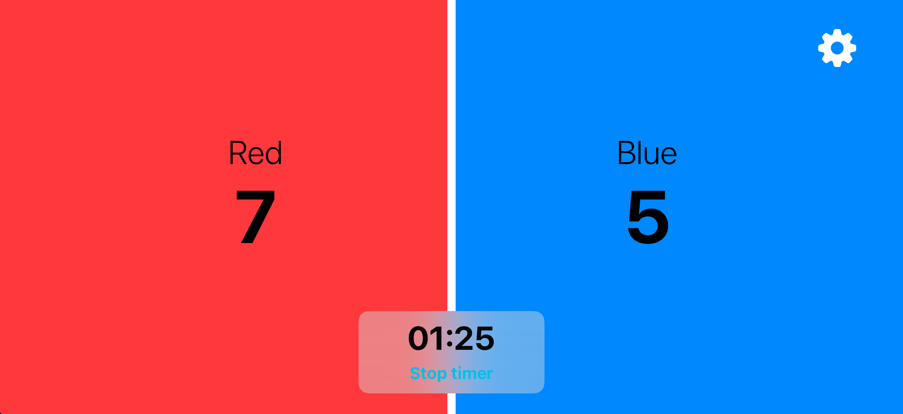

# Volleyball Score Tracker

A SwiftUI app for keeping score during volleyball matches. I built it to score children's games at a youth summer camp.



## Features

- Tap a team's half of the screen to add a point, swipe down to take one away.
- Match timer with start, pause, resume and reset.
- Optional winning score. When a team reaches it, the app announces the winner with confetti and blocks further scoring. Lowering a score or raising the target withdraws the result.
- Haptic feedback for every scoring action, and a distinct error haptic when scoring is blocked.
- Double tap a team to rename it or set its score by hand.

## How it's built

- **SwiftUI** for all views, including a full-screen cover for team settings and an animated settings overlay.
- **MVVM**: `ScoreCounter`, `GameTimer`, `TeamProperties` and `AppSettingsModel` are `ObservableObject` view models, owned by the root view with `@StateObject` and passed down as `@ObservedObject`.
- **Combine** drives the match timer through `Timer.publish`, so the elapsed time survives pausing and resuming.
- **Swift Package Manager** for the one dependency, [ConfettiSwiftUI](https://github.com/simibac/ConfettiSwiftUI).

```
ScoreCounterApp/
├── Other/        App entry point and assets
├── ViewModels/   Score, timer, team and settings state
└── Views/        Main scoreboard, app settings, team settings
```

## Running it

Requirements: Xcode 16.4 or newer, iOS 18.5 or newer, iPhone.

1. Clone the repository and open `ScoreCounterApp.xcodeproj`.
2. Xcode resolves ConfettiSwiftUI automatically through Swift Package Manager.
3. Pick an iPhone simulator or device and press Run.

The scoreboard is designed for landscape, with one team on each half of the screen.
